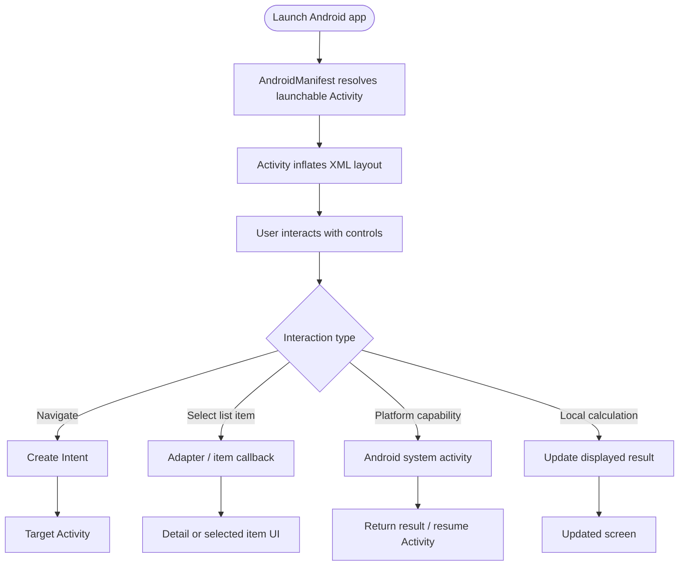

# 📱 Belajar Android Activity

<p align="center">
  <strong>A Kotlin-based Android learning application with practical Activity, XML layout, Adapter, Intent, and UI component examples.</strong>
</p>

<p align="center">
  <a href="https://github.com/Brajesh31/Android-Development">Repository</a> ·
  <a href="docs/README.md">Documentation</a> ·
  <a href="CONTRIBUTING.md">Contributing</a> ·
  <a href="ROADMAP.md">Roadmap</a>
</p>

> [!NOTE]
> This repository is an Android learning project. It contains multiple screens and demonstrations, not a production-ready application architecture. Review the manifest and activity navigation carefully before publishing a release.

## 📚 Table of Contents

1. [🌟 Project Overview](#-project-overview)
2. [🎯 Learning Objectives](#-learning-objectives)
3. [✨ Feature Catalogue](#-feature-catalogue)
4. [🧭 Application Flow](#-application-flow)
5. [🏗️ Architecture](#️-architecture)
6. [🧰 Technology Stack](#-technology-stack)
7. [🗂️ Repository Structure](#️-repository-structure)
8. [🖥️ Requirements](#️-requirements)
9. [🚀 Setup and Installation](#-setup-and-installation)
10. [▶️ Build and Run](#️-build-and-run)
11. [🧪 Testing](#-testing)
12. [♿ Accessibility](#-accessibility)
13. [🔐 Security and Permissions](#-security-and-permissions)
14. [📦 Release and Distribution](#-release-and-distribution)
15. [🧯 Troubleshooting](#-troubleshooting)
16. [🤝 Contributing](#-contributing)
17. [🗺️ Roadmap](#️-roadmap)
18. [📖 Documentation](#-documentation)
19. [📄 License and Third-Party Notices](#-license-and-third-party-notices)

---

## 🌟 Project Overview

**Belajar Android Activity** is a Kotlin and Android Studio learning application. Its source tree contains examples of activities, XML layouts, adapters, data models, drawable assets, fonts, themes, camera launching, calculator interaction, travel/detail screens, lists, and a daily-prayer (doa) experience.

The project is useful for learning how an Android application is assembled from:
- Kotlin activity and adapter classes.
- XML layout resources.
- AndroidManifest declarations.
- String, color, and theme resources.
- Drawable and font assets.
- Gradle build configuration.
- Unit and instrumented test source sets.

It is not currently documented as a commercial service, cloud-connected product, or production architecture. No backend or database integration is established by the repository structure.

## 🎯 Learning Objectives

By exploring the project, learners can practise:

- Understanding Android Activity responsibilities and lifecycle.
- Connecting Kotlin code to XML layouts.
- Navigating between screens with Intents.
- Displaying data using RecyclerView-style adapter patterns.
- Creating item layouts and binding model data.
- Organizing images, vector drawables, shapes, fonts, and strings.
- Applying themes and colors through resource files.
- Structuring a Gradle-based Android project.
- Launching platform capabilities such as the camera through Android APIs.
- Writing local unit tests and Android instrumentation tests.
- Reviewing runtime permissions and manifest declarations.

## ✨ Feature Catalogue

The source tree indicates the following learning areas. The table describes code areas, not a guarantee that every flow has been fully tested on a device.

| Area | Source examples | Learning focus |
|---|---|---|
| Main navigation and dashboards | `MainActivity.kt`, `Home.kt`, `Dashboard.kt` | Activity screens and navigation |
| Calculator | `Calculator.kt` | Input handling and simple calculations |
| Count example | `CountActivity.kt` | Stateful UI interaction |
| Lists and practice | `List.kt`, `LatihanList.kt`, `ListPemrograman.kt` | Collections and list presentation |
| Language catalogue | `Language.kt`, `LanguageAdapter.kt` | Model and adapter separation |
| Daily prayer | `DoaHarianActivity.kt`, Doa classes and adapters | Repeated content and item binding |
| Detail screens | `Detail.kt`, `DetailStore.kt` | Passing and presenting selected item data |
| Camera launch | `OpenCamera.kt` | Android platform intent and permission considerations |
| Scrolling and visibility | `ScrollView.kt`, `Visibility.kt` | Layout behaviour and visibility |
| Cards and travel | `card.kt`, `Travel.kt` | Visual components and detail presentation |
| Splash example | `splashScreen.kt` | Startup screen demonstration |

See [docs/FEATURES.md](docs/FEATURES.md) for a more detailed file-to-feature inventory.

## 🧭 Application Flow

The exact navigation graph should be confirmed against the current Intent calls and manifest declarations. Conceptually, the app is organized around independently implemented learning screens:



This is a conceptual learning diagram. It does not assert that every screen is reachable from one single home screen. The manifest currently exposes several activities with launcher filters according to the existing README, so entry-point behaviour should be reviewed before release.

## 🏗️ Architecture

The project follows a traditional Android structure with Kotlin source and XML resources:

| Layer | Location | Responsibility |
|---|---|---|
| Activity/UI controller | `app/src/main/java/**` | Screen lifecycle, user events, navigation |
| Adapter | `adapter/` and Doa adapter classes | Bind collections to list item views |
| Models | `model/` | Represent display data |
| Layout resources | `res/layout/` | XML view hierarchies |
| Drawables | `res/drawable/` | Images, icons, vector and shape resources |
| Values | `res/values/` | Strings, colors, themes and font metadata |
| Manifest | `AndroidManifest.xml` | Application components and platform declarations |
| Build | Gradle Kotlin DSL | Plugins, Android configuration and dependencies |
| Tests | `src/test`, `src/androidTest` | JVM and device/emulator test sources |

This is a learning-oriented organization. It is not necessarily a strict MVVM, Clean Architecture, or repository-pattern implementation.

## 🧰 Technology Stack

| Technology | Role |
|---|---|
| Kotlin | Main application language |
| Android SDK | Android platform APIs |
| Android Studio | Recommended IDE |
| Gradle Kotlin DSL | Project and module build configuration |
| AndroidX | Android support libraries |
| Material Components | Material UI components |
| ConstraintLayout | Flexible XML layout positioning |
| Glide | Image loading |
| Glide Transformations | Image transformation utilities |
| Lottie | JSON-based animation rendering |
| JUnit / Android test tooling | Test source infrastructure |

The root and app Gradle files remain authoritative for exact plugin and dependency versions. Do not assume a library version from this README.

## 🗂️ Repository Structure

```text
Android-Development/
├── app/
│   ├── build.gradle.kts
│   ├── proguard-rules.pro
│   └── src/
│       ├── main/
│       │   ├── AndroidManifest.xml
│       │   ├── java/com/example/
│       │   │   ├── belajarandroidactivity/
│       │   │   ├── adapter/
│       │   │   ├── model/
│       │   │   └── Doa/
│       │   └── res/
│       │       ├── drawable/
│       │       ├── font/
│       │       ├── layout/
│       │       ├── mipmap-*/
│       │       ├── raw/
│       │       ├── values/
│       │       ├── values-night/
│       │       └── xml/
│       ├── test/
│       └── androidTest/
├── gradle/wrapper/
├── docs/
├── .github/
├── build.gradle.kts
├── settings.gradle.kts
├── gradle.properties
├── gradlew
├── gradlew.bat
├── gradle/wrapper/gradle-wrapper.properties
├── README.md
├── LICENSE
└── repository policies and templates
```

## 🖥️ Requirements

The current repository documentation identifies these baseline requirements:

- Android Studio with Android SDK 34 installed.
- A JDK compatible with the Android Gradle Plugin configured by the project.
- Android emulator or physical device running Android API 29 or newer for the documented test target.
- Internet connectivity for initial Gradle dependency resolution.
- Sufficient disk space for Gradle caches, Android SDK platforms, emulator images, and build outputs.

Check the Gradle plugin and wrapper versions in the project files before choosing or upgrading a JDK. Do not update Gradle, Kotlin, or Android Gradle Plugin versions independently.

## 🚀 Setup and Installation

### 1. Clone the repository

```bash
git clone https://github.com/Brajesh31/Android-Development.git
cd Android-Development
```

### 2. Open in Android Studio

1. Launch Android Studio.
2. Choose **Open**.
3. Select the cloned repository root, not the `app/` directory.
4. Allow Gradle sync to complete.
5. Install the SDK platform and build tools requested by the project if they are missing.
6. Review any sync warnings before changing configuration.

### 3. Verify the Gradle wrapper

The repository includes `gradlew`, `gradlew.bat`, and `gradle/wrapper/`. Use the wrapper so the project is built with its declared Gradle distribution.

On macOS/Linux, the wrapper may need executable permission:

```bash
chmod +x gradlew
```

## ▶️ Build and Run

From the repository root:

**macOS/Linux**
```bash
./gradlew tasks
./gradlew assembleDebug
./gradlew test
./gradlew connectedAndroidTest
```

**Windows PowerShell**
```powershell
.\gradlew.bat tasks
.\gradlew.bat assembleDebug
.\gradlew.bat test
.\gradlew.bat connectedAndroidTest
```

The debug APK is normally generated under `app/build/outputs/apk/debug/`, subject to the module's build configuration.

To run on a device:
1. Enable developer options and USB debugging where appropriate.
2. Connect the device and authorize the development computer.
3. Select the app run configuration in Android Studio.
4. Choose the target device.
5. Build and run.
6. Review Logcat for runtime exceptions and permission failures.

Do not install a debug build as if it were a signed production release.

## 🧪 Testing

The repository contains example source files under:
- `app/src/test/` for local JVM tests.
- `app/src/androidTest/` for tests that require Android runtime/device behaviour.

Run:

```bash
./gradlew test
./gradlew connectedAndroidTest
```

The existence of example test classes does not mean all screens have meaningful assertions. See [docs/TESTING.md](docs/TESTING.md) for the recommended test matrix and current coverage boundaries.

## ♿ Accessibility

Accessibility should be considered on every screen, not added at the end.

Review:
- Touch target size and spacing.
- Text contrast against backgrounds.
- Text scaling and display-size changes.
- Content descriptions for meaningful images and icon-only controls.
- Logical focus order and TalkBack announcements.
- Error messages that identify the field and corrective action.
- Large font clipping in constrained layouts.
- Color use that does not rely on hue alone.
- Motion and animation sensitivity.
- Keyboard and switch-access support where relevant.

See [docs/ACCESSIBILITY.md](docs/ACCESSIBILITY.md).

## 🔐 Security and Permissions

Before adding a component or platform capability:
- Request only the permissions the feature needs.
- Prefer system pickers and intents where they avoid broad permissions.
- Request runtime permissions in context, not immediately on launch.
- Handle denial and permanent denial states.
- Do not log personal data or sensitive content.
- Do not hardcode API keys, passwords, or tokens in source or resources.
- Validate external Intent input before using it.
- Review backup and data-extraction rules.
- Keep exported components disabled unless external access is required.

The camera example requires careful review of the current manifest and implementation. See [SECURITY.md](SECURITY.md) and [docs/SECURITY-AND-PERMISSIONS.md](docs/SECURITY-AND-PERMISSIONS.md).

## 📦 Release and Distribution

A release candidate should be checked for:
- A single intentional launcher entry point.
- Correct application ID, version code, and version name.
- Appropriate minimum and target SDK values.
- Release signing configuration managed outside source control.
- No debug-only logging or test data.
- Permission declarations justified by active features.
- Backup/data-extraction behaviour reviewed.
- Accessibility and UI checks completed.
- Unit and instrumented tests executed.
- Third-party licence obligations documented.

Never commit signing keys, keystores, passwords, or Play Console credentials.

## 🧯 Troubleshooting

| Problem | What to check |
|---|---|
| Gradle sync fails | JDK, Android Gradle Plugin, wrapper distribution, network, SDK |
| SDK platform missing | Install the compile SDK configured in Gradle |
| Build fails after dependency change | Inspect Gradle resolution and version compatibility |
| App opens unexpected screen | Review all launcher intent filters in manifest |
| Camera screen fails | Check camera intent, runtime permission strategy, and device capability |
| Images do not load | Verify resource name, drawable path, and Glide request |
| Layout clips text | Test font scaling and smaller widths |
| Instrumentation tests cannot run | Start an emulator or connect an authorized device |
| APK cannot install | Check min SDK, device ABI, signature conflict, and package ID |

See [docs/TROUBLESHOOTING.md](docs/TROUBLESHOOTING.md) for expanded diagnostic steps.

## 🤝 Contributing

Contributions that improve learning value, correctness, accessibility, lifecycle safety, and test coverage are welcome.

Before submitting:
- Read [CONTRIBUTING.md](CONTRIBUTING.md).
- Keep existing Kotlin, XML, and Gradle changes focused.
- Test the affected activity and navigation.
- Check dark mode, text scaling, and device sizes where UI changes.
- Avoid adding permissions without a clear feature requirement.
- Do not commit build output, local IDE state, or secrets.

## 🗺️ Roadmap

See [ROADMAP.md](ROADMAP.md) for proposed improvements such as navigation cleanup, lifecycle-safe architecture, stronger test coverage, accessibility audits, and release readiness.

## 📖 Documentation

| Document | Description |
|---|---|
| [Documentation index](docs/README.md) | All project guides |
| [Features](docs/FEATURES.md) | Activity, adapter, and screen inventory |
| [Architecture](docs/ARCHITECTURE.md) | App layers and component responsibilities |
| [Activity lifecycle](docs/ACTIVITY-LIFECYCLE.md) | Activity lifecycle and state handling |
| [Navigation and intents](docs/NAVIGATION.md) | Screen navigation and intent safety |
| [Resources and layouts](docs/RESOURCES-AND-LAYOUTS.md) | XML, drawable, font, and values resources |
| [Accessibility](docs/ACCESSIBILITY.md) | Android accessibility checklist |
| [Security and permissions](docs/SECURITY-AND-PERMISSIONS.md) | Manifest, runtime permissions, and sensitive data |
| [Testing](docs/TESTING.md) | Unit, instrumentation, and manual UI testing |
| [Build and release](docs/BUILD-AND-RELEASE.md) | Gradle commands and release checks |
| [Development](docs/DEVELOPMENT.md) | Contributor development workflow |
| [Troubleshooting](docs/TROUBLESHOOTING.md) | Common build and runtime problems |
| [FAQ](docs/FAQ.md) | Frequently asked questions |
| [Deployment](docs/DEPLOYMENT.md) | APK build and distribution boundaries |
| [Contributing](CONTRIBUTING.md) | Contribution process |
| [Security](SECURITY.md) | Security reporting |
| [Code of Conduct](CODE_OF_CONDUCT.md) | Community standards |
| [Support](SUPPORT.md) | Support and issue reporting |
| [Maintainers](MAINTAINERS.md) | Repository maintenance |
| [Governance](GOVERNANCE.md) | Project decision process |
| [Changelog](CHANGELOG.md) | Change history |
| [License](LICENSE) | MIT license text |

## 📄 License and Third-Party Notices

Original project code and documentation are distributed under the MIT License in [LICENSE](LICENSE). Third-party libraries, fonts, icons, images, and other assets may have separate licences and attribution requirements. Review the upstream licence terms before redistributing assets. See [THIRD-PARTY-NOTICES.md](THIRD-PARTY-NOTICES.md).

---

**Maintained by Brajesh Kumar** · [GitHub](https://github.com/Brajesh31)

Last updated: 2026-11-20 02:04 UTC
