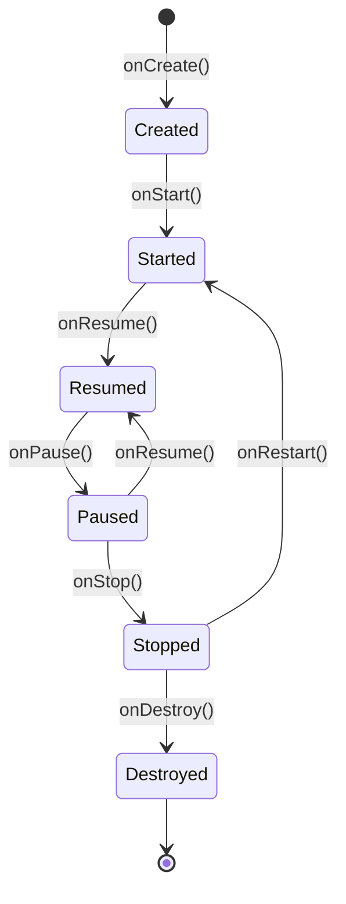

# 🔄 Android Activity Lifecycle and State

An Activity is a user-facing component managed by Android. The system may pause, stop, destroy, or recreate it due to navigation, configuration changes, and memory pressure.

## Lifecycle sequence

The exact callback sequence depends on the event and Android version. Do not rely on `onDestroy()` as a guaranteed persistence callback.

## Callback responsibilities

| Callback | Typical responsibility |
|---|---|
| `onCreate()` | Inflate layout, initialize views, restore saved state |
| `onStart()` | Activity becomes visible |
| `onResume()` | Activity is foreground and interactive |
| `onPause()` | Pause foreground-only work and release exclusive resources when needed |
| `onStop()` | Activity is no longer visible; stop UI-bound work |
| `onRestart()` | Activity is about to start again after stop |
| `onDestroy()` | Cleanup when destruction occurs; not guaranteed for process death |

## State and recreation

Rotation, language changes, font scaling, night mode, and other configuration changes can recreate an Activity. Store small UI state using saved instance state or a ViewModel where appropriate. Use persistent storage only for state that must survive process restarts.

## Resource ownership

Camera, sensor, media, and battery-sensitive resources should be acquired and released at lifecycle-appropriate points. Avoid holding resources when the screen is no longer active.

## Asynchronous work

Avoid updating views after an Activity is destroyed. Use lifecycle-aware scopes where applicable, cancel unneeded work, and avoid leaking Activity references.

## Review checklist

- [ ] Layout initialization occurs in the appropriate lifecycle phase.
- [ ] State restoration is considered.
- [ ] Long-running work does not block the main thread.
- [ ] Resources are released appropriately.
- [ ] Navigation does not depend on stale Activity references.
- [ ] Configuration changes are tested.
