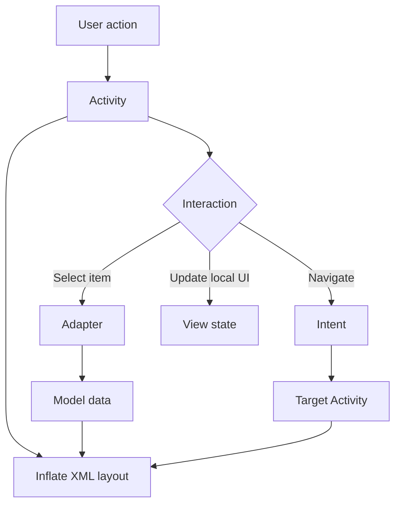

# 🏗️ Android Application Architecture

## Overview

The project is a traditional Kotlin Android application with XML-based views. Activities coordinate screens and user interactions; adapters bind collections; model classes represent item data; Android resources hold layouts and visual assets.

The structure is educational. It should not be described as strict MVVM, Clean Architecture, or repository-pattern architecture unless those patterns are introduced and consistently applied.

## Repository layers

| Area | Path | Responsibility |
|---|---|---|
| App configuration | `app/build.gradle.kts` | Android module configuration and dependencies |
| Project configuration | Root Gradle Kotlin DSL files | Plugins and module setup |
| Activity/UI | `app/src/main/java/com/example/belajarandroidactivity/` | Screens, lifecycle, events, navigation |
| Prayer feature | `Doa/` | Prayer screen support |
| Adapters | `adapter/` and feature adapters | Bind models into collection rows |
| Models | `model/` | UI data representation |
| Manifest | `AndroidManifest.xml` | Components and platform declarations |
| Layouts | `res/layout/` | XML view hierarchies |
| Visual resources | `drawable/`, `mipmap/`, `font/`, `raw/` | Images, icons, fonts, animation |
| Values | `values/`, `values-night/` | Strings, themes, colors |
| Platform configuration | `res/xml/` | Backup and extraction rules |
| JVM tests | `src/test/` | Local tests |
| Instrumented tests | `src/androidTest/` | Android runtime/device tests |

## Component interaction

This is a conceptual diagram. Verify actual Intent targets in source files.

## Manifest and entry points

The manifest currently exposes several learning screens with launcher filters according to the project README. This is suitable for experimentation but can create an unclear launch surface. Before publishing, choose one intentional launcher Activity and keep other Activities non-exported unless external access is required.

## Resource system

Layouts and visual values should remain in Android resources rather than being duplicated in Kotlin. Use resource qualifiers for night mode, localization, and density where relevant. Keep user-facing text in string resources.

## Lifecycle ownership

Activities may be destroyed and recreated because of configuration changes or system memory pressure. Do not treat Activity fields as durable storage. Save small UI state through saved-state mechanisms and use persistent storage only when needed.

## Future architecture improvements

- Separate UI state from event-handling code.
- Extract reusable calculation and formatting logic.
- Use ViewModel for screen state where justified.
- Introduce repositories only when data sources exist.
- Centralize navigation contracts.
- Add unit tests for pure logic and UI tests for critical flows.

These are potential improvements, not claims about current implementation.
