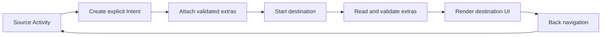

# 🧭 Android Navigation and Intents

This guide explains navigation in the existing Activity-based app. It does not assume a Navigation Component graph is present.

## Intent basics

An explicit Intent identifies a target component in the application.

```kotlin
val intent = Intent(this, Detail::class.java)
startActivity(intent)
```

This is illustrative. Use the actual target class and package in the feature being changed.

## Passing values

Use Intent extras for small, well-defined values such as an item identifier or title. Validate extras at the destination and handle missing or invalid values. Avoid passing large object graphs or sensitive content.

## Back navigation

Check that each screen has a clear back path. Avoid accidental duplicate Activity instances. Consider launch modes and task-stack behaviour only where required by UX.

## Manifest declarations

Every Activity should have an appropriate manifest declaration. Intent filters determine which external or implicit intents can resolve to a component. Exported components may be invoked by other apps.

The current manifest has multiple launcher filters according to the project README. Before release:
- Select one deliberate launcher Activity.
- Remove accidental launcher filters from sample screens.
- Set `android:exported` explicitly where required.
- Keep internal Activities non-exported unless external access is needed.
- Validate incoming actions, data, and extras.

## Platform intents

The camera example should be reviewed for its exact action. Prefer a system camera app or a modern activity-result contract where appropriate. Launching a camera app is not equivalent to direct camera hardware access.

## Conceptual navigation flow



## Review checklist

- [ ] Destination exists and is declared.
- [ ] Intent is explicit where possible.
- [ ] Extras are small and validated.
- [ ] No private data is exposed unnecessarily.
- [ ] Back navigation behaves consistently.
- [ ] Exported status and intent filters are deliberate.
- [ ] External input is treated as untrusted.
